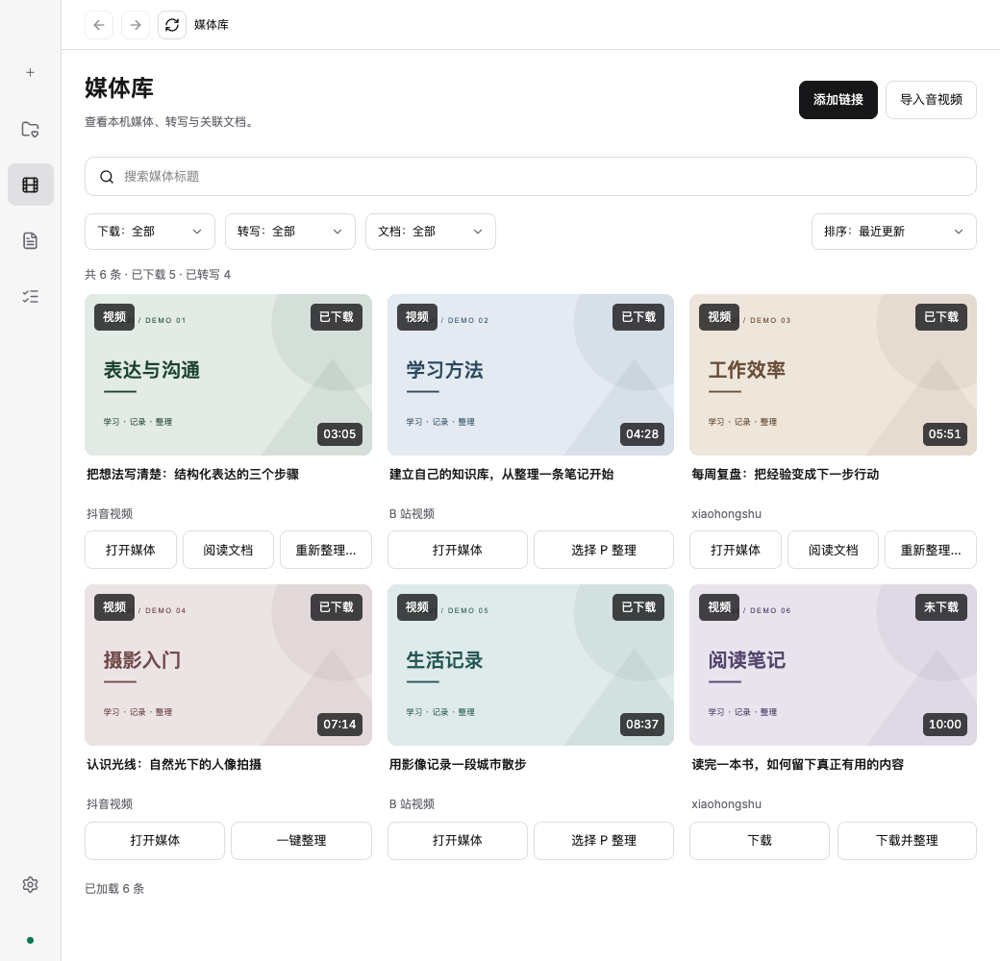
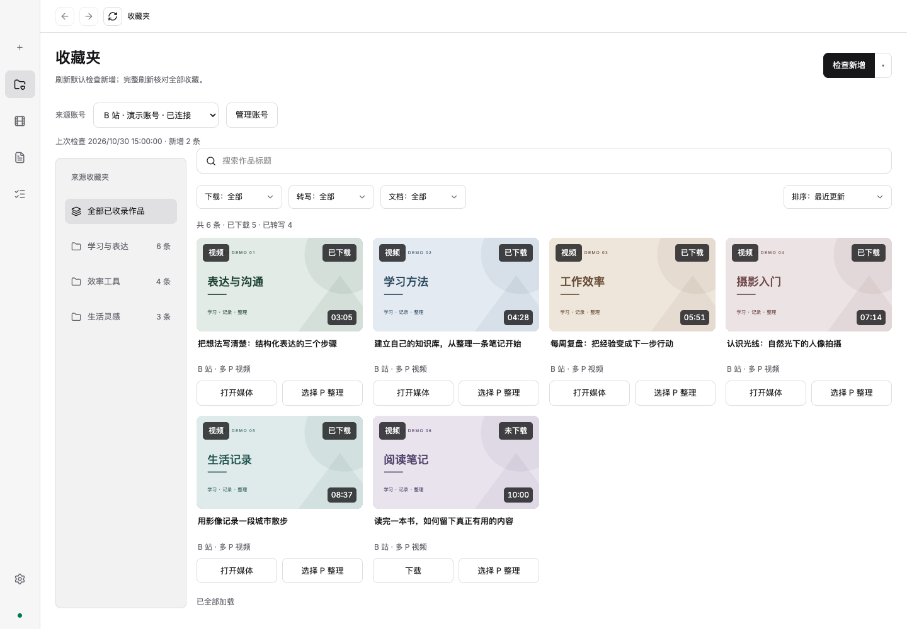
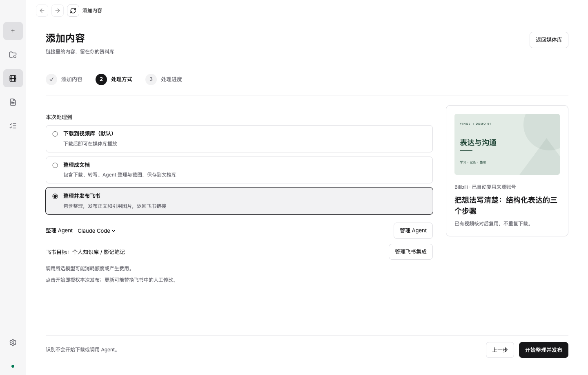
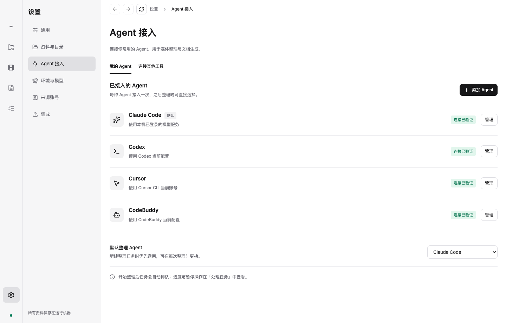
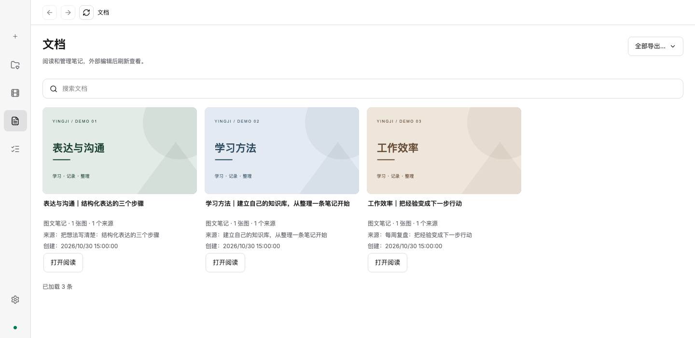
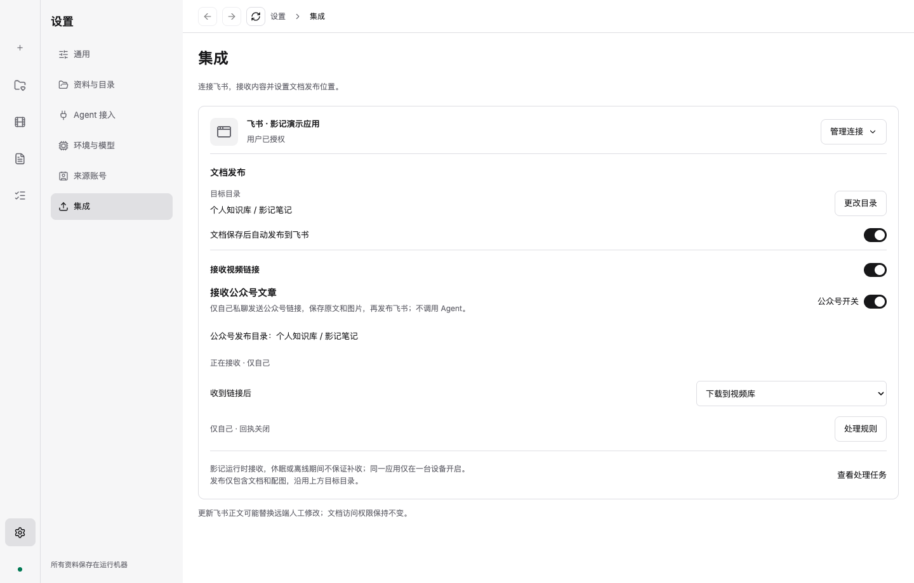

<p align="center">
  
</p>
<h1 align="center">影记 · Yingji</h1>
<p align="center"><strong>把收藏、视频链接和公众号文章，变成自己的资料库。</strong></p>
<p align="center">收藏与下载 · 本地转写 · AI 整理笔记 · 飞书接收与发布</p>
<p align="center">
  <a href="https://github.com/angrypandahu/yingji-releases/releases/latest">下载最新版</a> ·
  <a href="#快速开始">快速开始</a> ·
  <a href="#接入飞书">接入飞书</a> ·
  <a href="https://github.com/angrypandahu/yingji-releases/releases">更新记录</a> ·
  <a href="https://github.com/angrypandahu/yingji-releases/issues">反馈问题</a>
</p>

---

影记是一款以本地资料为中心的桌面应用。你可以整理抖音、小红书、B 站收藏，也可以直接粘贴视频或微信公众号文章链接，把内容保存到自己的电脑，并按需要整理成 Markdown 笔记、发布到飞书。

> 视频：添加链接或选择收藏 → 下载 → 本地转写 → 调用所选 Agent 整理 → 保存笔记 → 按需发布飞书
>
> 公众号：添加文章链接 → 保存原文与配图 → 发布飞书，无需调用 Agent



*以下截图重新截取自 v0.0.10 的实际界面渲染。账号、内容和连接状态均为演示数据，不包含个人资料，也不代表真实账号连接测试结果。*

## 现在能做什么？

### 收藏夹与媒体库，集中管理资料

- 连接抖音、小红书、B 站来源账号，刷新收藏夹、按标题查找内容，查看下载、转写和整理状态。
- 导入已有音视频，在本机播放、提取音轨、截取画面，并查看关联的转写和笔记。

平台内容能否读取或下载，取决于账号登录状态、内容权限和平台限制；需要登录时按应用提示完成。



### 添加一个链接，选择处理到哪一步

在“添加内容”中粘贴视频或公众号文章链接，影记会自动识别内容类型。视频提供三种处理方式：**下载到视频库、整理成文档、整理并发布飞书**；B 站多 P 视频可选择分 P。

选择整理时，可指定 Agent；选择发布时，会显示飞书目标目录。确认后再开始处理，识别链接本身不会启动下载或调用 Agent。



### 本地转写，交给常用的 Agent 整理

音视频转写在本机运行，模型需先下载。完成转写后，可结合文字稿与截图，由你选择的外部 Agent 整理笔记。

在“设置 → Agent 接入 → 我的 Agent”中接入 **Claude Code、Codex、Cursor 或 CodeBuddy**，完成准备和连接测试，再选择用于任务的 Agent。影记负责串联下载、转写、整理和保存，笔记正文由外部 Agent 生成。

对应工具的账号、模型权限与费用由你所使用的服务决定。



### Markdown 笔记，保留图片和来源

产出是本地 Markdown 文件，图片与来源媒体保留关联，可使用其他编辑器继续维护。在文档库中按标题搜索、打开阅读，也可从关联媒体继续查看转写与笔记。

也可通过 **REST API / MCP** 授权其他工具访问本地资料；授权后才能访问，随时可以撤销。



### 公众号文章，保存原文和图片

在“添加内容”中粘贴微信公众号文章链接，或通过已接入的飞书机器人发送给影记。完成飞书授权与发布目录配置后，影记会抓取文章，保存本地 Markdown 和配图，再发布到所选飞书文件夹。

此流程保存原文，不调用转写模型或 Agent。验证页、失效链接及部分特殊组件可能无法完整保存；任务中会显示处理结果或需要继续处理的原因，不保证还原公众号原始排版。

### 飞书收链接，处理后发布文档

- 给自己的飞书机器人发视频链接，按配置下载、整理或发布。
- 发公众号文章链接，保存原文和配图后发布到飞书。
- 支持手动发布文档，也可开启“文档保存后自动发布到飞书”。
- 已发布文档可在影记中打开或复制对应的飞书链接。

默认仅接收当前授权用户的私聊消息。影记与电脑需要保持运行；离线、退出或休眠期间不保证补收，同一应用建议只在一台设备开启接收。发布内容为文档与配图，原始音视频保留在本地。



### 统一查看进度，继续失败的任务

在“处理任务”中查看视频与公众号的处理步骤、状态和详细日志。失败后按提示继续或重试，已经完成的下载、转写或文档成果会保留；发布失败可继续发布。

还可为收藏夹设置每日增量计划：首次扫描建立历史基线，之后处理新增内容。计划需要电脑唤醒且影记运行；整理失败会暂停相应 Agent 的后续自动处理，等待你检查。

## 接入飞书

1. 在“设置 → 集成”中选择已有飞书应用，或新建应用。**建议优先使用个人飞书账号，并选择自己管理的组织**；飞书后台仍将此类应用称为“企业自建应用”。
2. 在自动打开的浏览器页面完成应用连接与用户授权。影记会自动配置授权回调地址；失败时可在“授权帮助”中复制地址、打开当前应用的安全设置补充配置。
3. 选择飞书目标文件夹，并按接入说明核对机器人能力、消息权限、事件订阅和长连接设置；按飞书后台要求完成应用发布。
4. 核对接收开关与处理方式，点击“完成接入并开启接收”，再发送一条自己的链接测试。

首次接入时，**自动发布、接收视频链接、接收公众号文章、接收与结果回执默认选中**，也可自行关闭。自动发布在确认目录后生效，两类接收与回执在完成接入后生效；同一身份已保存的关闭选择会保留，新应用或新授权用户重新进入首次配置。

v0.0.12 的「收到链接后」首次默认选择**整理并发布飞书**；仍需可用 Agent、目标目录并完成接入后生效，已有处理方式保持。接入后可点击应用卡片上的**打开飞书聊天**进入当前机器人的会话；此操作不会自动发消息。

消息回复还需要「以应用的身份发消息」权限。v0.0.11 的应用接入已补齐申请；已有应用若缺少此权限，请在飞书后台开通并核对生效状态。旧收件保持接收时的回执设置，结果未知时可在核对后仅重发回执，无需重复处理内容。

公司组织可能需要管理员审批，影记不能替代飞书的审核规则。再次发布文档可能覆盖飞书中的人工修改，建议在本地 Markdown 中维护正文。

## 下载与更新

当前版本：**[v0.0.12](https://github.com/angrypandahu/yingji-releases/releases/tag/v0.0.12)**。

| 平台 | 下载 |
| --- | --- |
| macOS · Apple Silicon（M 系列） | [下载 v0.0.12 DMG](https://github.com/angrypandahu/yingji-releases/releases/download/v0.0.12/Yingji-0.0.12-macOS-arm64.dmg) |
| Intel Mac、Windows、Linux | 当前公开版本未提供安装包 |

已安装用户可在“设置 → 通用 → 应用更新”中检查、下载并重启安装。v0.0.11 → v0.0.12 支持增量更新；其他支持应用内更新的版本使用完整更新包。更新前请结束正在运行的任务。

Release 中的 `update`、`delta` ZIP 和 `update.json` 供应用内更新使用，手动安装只需下载 DMG。`SHA256SUMS.txt` 用于核对文件完整性，FFmpeg 源码附件用于履行第三方许可证要求。

### macOS 首次打开（重要）

> **提示“应用已损坏，无法打开”或“无法验证开发者”？**
> 当前安装包尚未经过 Apple Developer ID 公证。请先确认安装包来自本仓库的 [正式 Release](https://github.com/angrypandahu/yingji-releases/releases/latest)，并将 `Yingji.app` 拖入“应用程序”，再打开 macOS「终端」执行：

```bash
xattr -dr com.apple.quarantine "/Applications/Yingji.app"
```

执行成功后通常没有输出，重新双击“应用程序”中的影记即可。该命令仅移除这份应用的下载隔离标记，不会删除影记资料，也不会关闭系统的全局安全保护。

- **提示没有该文件（No such file）**：确认已将应用复制到“应用程序”，而不是仍从 DMG 打开。若安装在其他位置或保留旧名 `Harbor Yingji.app`，请将命令中的路径改为实际应用路径，并保留双引号。
- **提示权限不足（Permission denied / Operation not permitted）**：确认路径无误后，可执行下方命令。终端会要求输入 Mac 登录密码，输入时不会显示字符：

  ```bash
  sudo xattr -dr com.apple.quarantine "/Applications/Yingji.app"
  ```

若仍被拦截，可在“系统设置 → 隐私与安全性”中按提示允许打开。移除隔离标记不能修复真正损坏的安装包；仍无法打开时，请重新下载正式 DMG。

## 快速开始

1. **安装影记**：下载 DMG，将 `Yingji.app` 拖到“应用程序”。首次打开如被 macOS 拦截，请先按上方「macOS 首次打开（重要）」执行 `xattr` 命令，再打开应用。
2. **准备资料目录与环境**：选择本地资料文件夹，按提示准备运行环境；需要音视频转写时，再下载转写模型。
3. **添加第一份内容**：直接粘贴视频链接，或在“设置 → 来源账号”连接账号后刷新收藏夹。需要整理笔记时接入并测试 Agent；需要处理公众号或发布文档时完成飞书配置。

首次准备环境、下载模型和使用在线来源需要联网。模型就绪后可在本机转写；外部 Agent、内容抓取和飞书发布是否需要联网，取决于对应服务。

## 资料与账号如何保存？

| 你关心的 | 影记的做法 |
| --- | --- |
| 媒体、笔记和图片放哪？ | 保存在你选择的本地资料目录；Markdown 是笔记正文 |
| 转写会上传音视频吗？ | 转写在本机完成 |
| 来源账号如何保存？ | 可选择系统加密保存登录信息，或仅本次使用；仅本次使用在退出后需重新登录 |
| AI 如何处理资料？ | 整理任务由你接入的外部 Agent 执行，相关内容的处理方式取决于该工具和服务 |
| 发布到飞书会上传什么？ | 文档与配图上传到你选择的飞书目录，原始音视频不随文档发布 |
| 有云同步吗？ | 当前客户端暂不开放云端登录与资料同步 |

当前集成入口仅开放飞书；微信直接接收与 Obsidian 集成暂不开放。公众号文章仍可通过“添加内容”或飞书机器人接收。

## 常见问题

<details>
<summary><strong>升级会删除资料或要求重新配置吗？</strong></summary>

正常应用内更新或覆盖安装会保留本地资料、模型、运行环境和已有授权。v0.0.11 → v0.0.12 已验证实际安装升级、资料关联及 Agent 授权保留。升级前请结束任务，不要删除自己的资料目录。

</details>

<details>
<summary><strong>升级后提示“环境尚未准备”，怎么办？</strong></summary>

点击“开始准备”重新核对环境。运行环境或资源清单变化时可能需要这一步，无需因此清空资料或重新配对 Agent。

</details>

<details>
<summary><strong>飞书开关选中了，为什么还没收到内容？</strong></summary>

首次选中代表待完成的配置。请完成用户授权、选择目录并点击完成接入，再核对飞书后台机器人权限、事件订阅、长连接和应用发布状态。保持影记运行，使用当前授权账号私聊发送一条文本链接测试。

</details>

<details>
<summary><strong>下载或整理失败后要全部重来吗？</strong></summary>

先在“处理任务”中查看失败步骤和日志，再使用对应的继续或重试入口。已有成果会保留；例如文档已生成而飞书发布失败时，可以继续发布，无需重新整理。

</details>

## 反馈与许可证

遇到问题，请在 [Issues](https://github.com/angrypandahu/yingji-releases/issues) 中提供应用版本、系统版本、复现步骤和错误提示。可在“设置 → 通用 → 诊断日志”导出诊断信息；提交截图或日志前检查是否含私人内容，不要上传账号凭据或整个资料目录。

此仓库提供影记的公开安装包、更新附件与发行说明。FFmpeg 等第三方组件的版权与许可证随应用分发，对应源码见各版本的 Release 附件。
