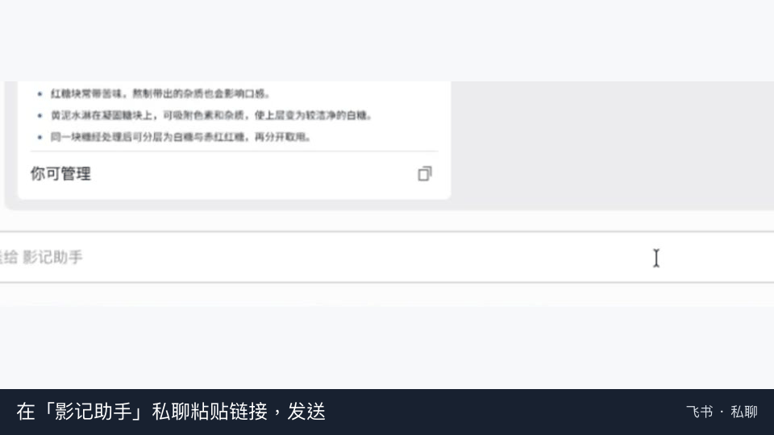
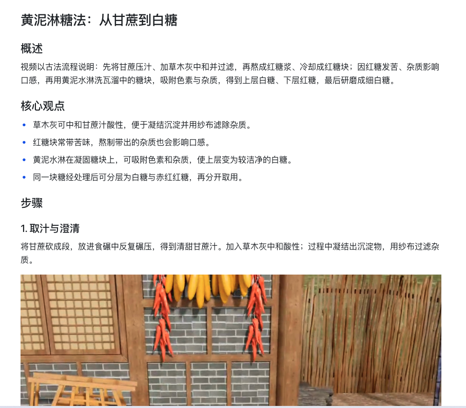
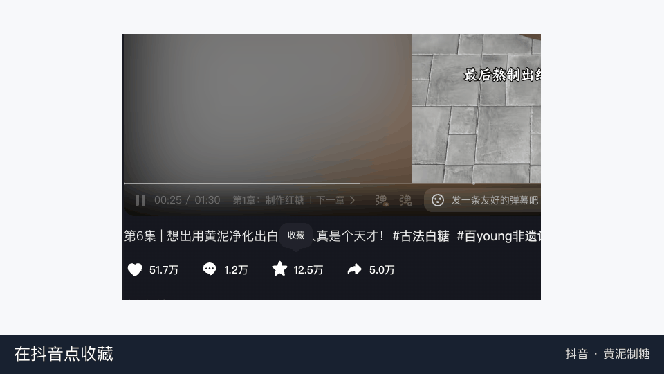

# 影记 · Yingji

**把视频发给飞书里的「影记助手」，在同一个私聊里打开配图笔记。** 平时收藏在抖音、小红书、B 站的作品，也能同步到电脑，挑选值得整理的内容。

[下载 Mac 版（Apple Silicon）](https://github.com/angrypandahu/yingji-releases/releases/download/v0.1.1/Yingji-0.1.1-macOS-arm64.dmg)　·　[看收藏夹同步](#collections)　·　[安装与快速开始](#install)

## 在飞书发一条视频，收回一篇笔记

首装完成后点 **「复制示例链接，打开飞书」**，在「影记助手」私聊里粘贴、发送。选择「整理并发布飞书」并开启回执后，影记会把笔记链接发回这个私聊。在电脑上保持影记运行，就可以在「处理任务」查看进度。

**这条视频整理出来是什么样？** 打开《黄泥淋糖法：从甘蔗到白糖》，可以直接读到要点和操作步骤，往下看就是对应的视频画面。

## 在抖音点收藏，回到影记找到它

在 **「设置 → 来源账号」** 连接账号。在平台照常收藏，回到影记的 **「收藏夹 → 检查新增」** 就能更新作品列表。这里实录的是抖音：搜「黄泥」，出现的就是刚点过星标的那条视频。点开卡片可查看已有笔记，其他操作收在「更多」里。

想每天自动整理新增视频，可以去 **「处理任务 → 定时任务」** 选收藏夹、时间和整理助手。首次扫描只记录已有作品。以后的新增视频才会进入下载、转写和整理流程。电脑休眠错过检查，影记会在下次启动或唤醒后补查。

## 安装与快速开始

1. **安装桌面端。** 从正式发行页下载 Mac Apple Silicon 的 DMG，将影记拖入「应用程序」。目前的 Mac 安装包使用 ad-hoc 签名，尚未经 Apple 公证。[v0.1.1 发行说明与校验文件](https://github.com/angrypandahu/yingji-releases/releases/tag/v0.1.1)
2. **选本地资料目录和整理助手。** 按向导准备运行环境并测试助手连接。视频转写在本机完成，笔记由你选的外部 Agent 整理。
3. **选一个入口试用。** 想用飞书就跟向导授权、选好笔记目录并试发一条；想整理已有收藏就连接来源账号，再去收藏夹检查新增。

飞书里还能发什么？

开启公众号文章接收后，可以在私聊发送微信公众号文章链接，保存原文与配图。视频和文章的接收方式可在「设置 → 集成」调整。

我发了链接，却没收到笔记

使用完成授权的账号私聊「影记助手」，确认电脑唤醒、影记正在运行，收件方式为「整理并发布飞书」，并已开启回执。在「处理任务」查看这条消息；如果提示来源或助手未就绪，恢复登录或测试连接后点「继续原收件」。

资料保存在哪里？已有版本如何升级？

原始音视频、本地 Markdown 和配图保存在你选择的资料目录。发布到飞书的是文档及配图。如果启动时找不到原资料库，可以重新定位它，或启用独立新库。已安装 v0.1.0 的 Mac 用户可以在「设置 → 通用 → 应用更新」增量升级到 v0.1.1。

[历次更新](https://github.com/angrypandahu/yingji-releases/releases)　·　[反馈问题](https://github.com/angrypandahu/yingji-releases/issues)
